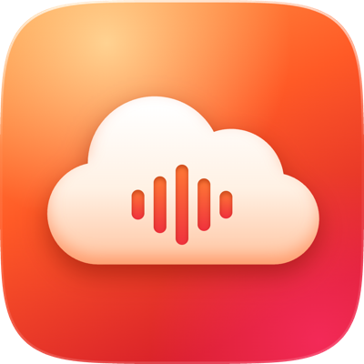
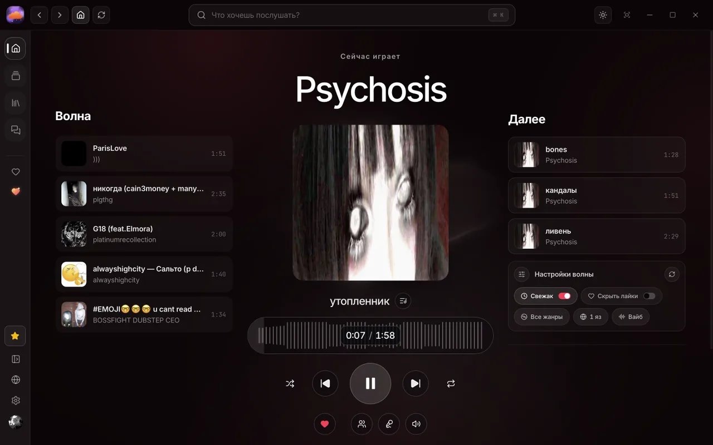
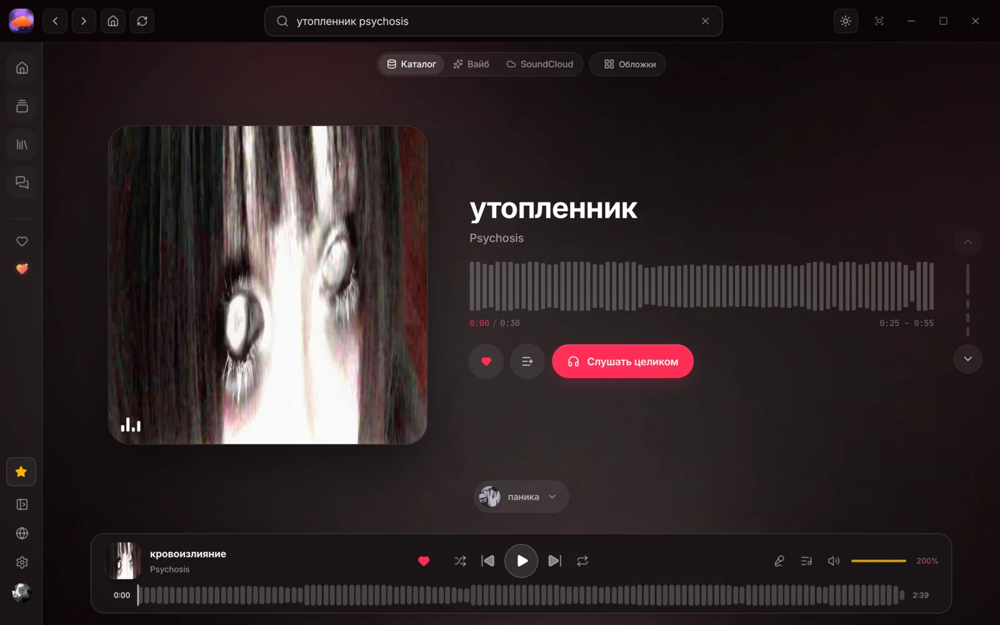
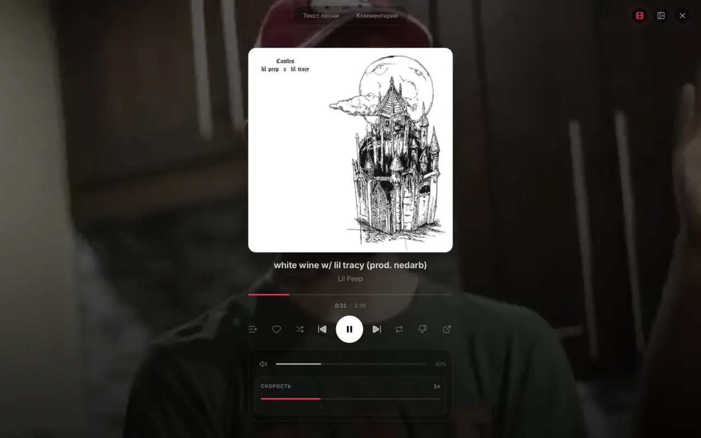
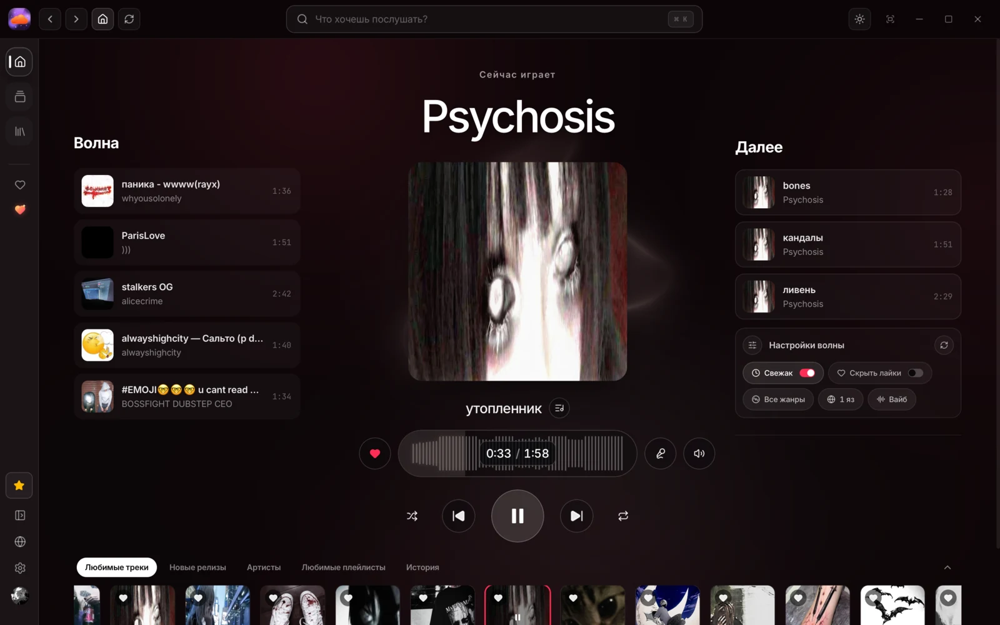
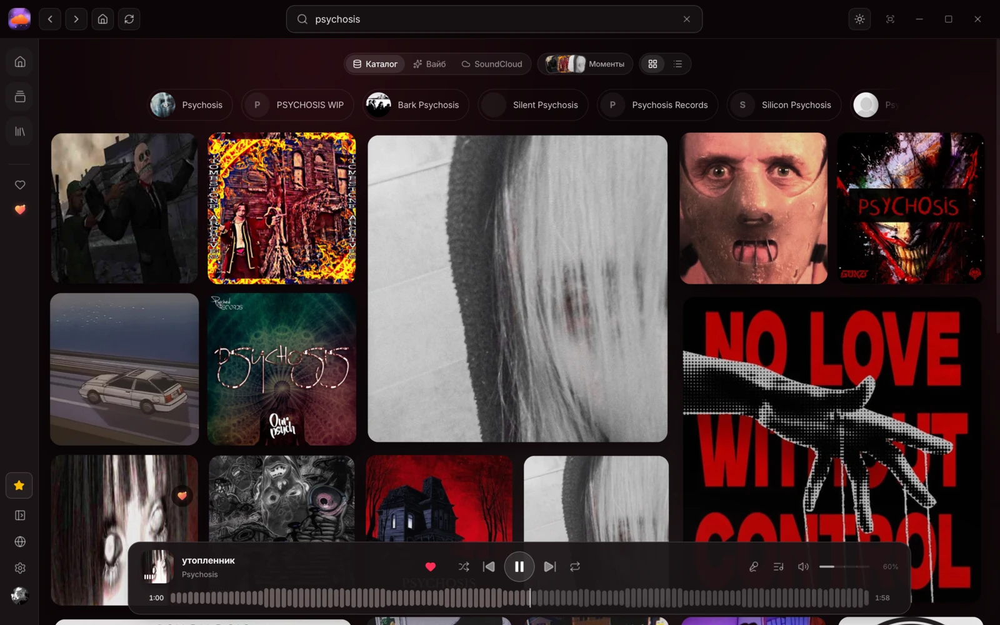
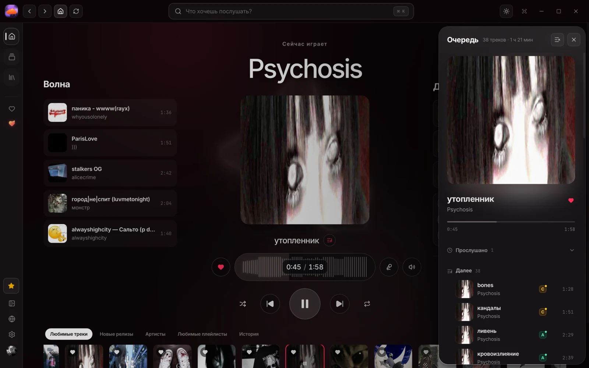
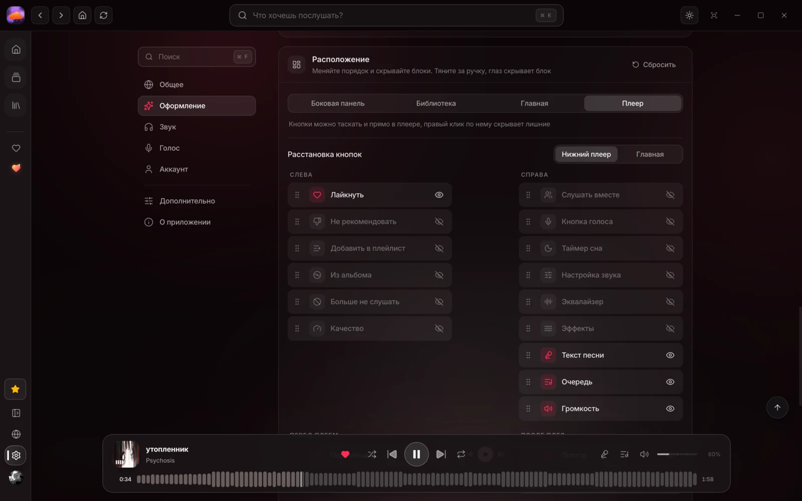
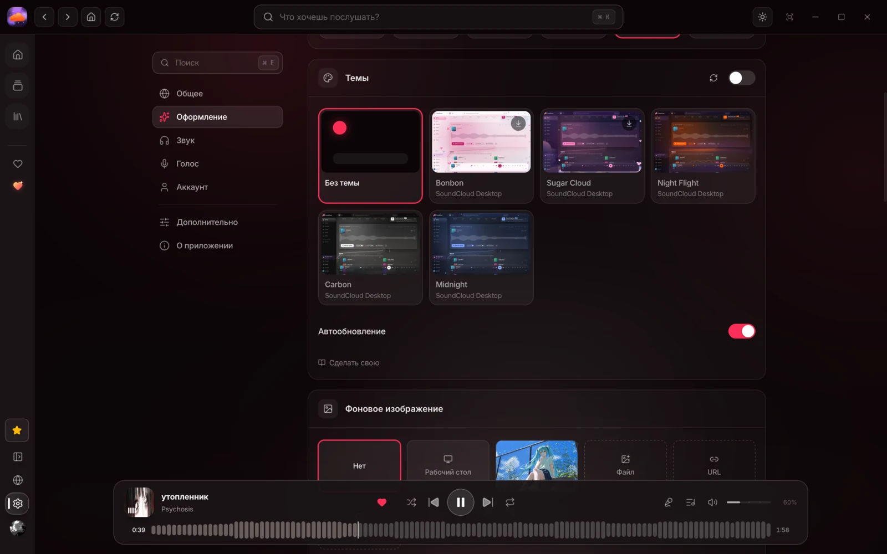
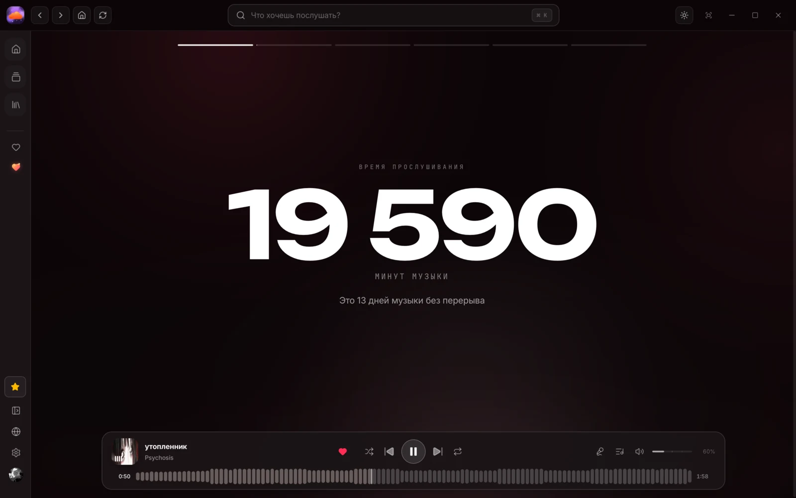

<p align="center">
<a href="https://getsoundcloud.app/">

</a>
</p>

<h1 align="center"><a href="https://getsoundcloud.app/">SoundCloud Desktop</a></h1>

<p align="center">
<b>SoundCloud на компьютере. Каким он должен быть.</b><br>
Без рекламы. Без капчи. Доступно в России. Бесплатно.
</p>

<p align="center">
<b>Скачать бесплатно</b><br><br>
<a href="https://github.com/zxcloli666/SoundCloud-Desktop/releases/latest/download/soundcloud-desktop_x64-setup.exe"></a>
<a href="#macos"></a>
<a href="#linux"></a>
<a href="https://github.com/okeydw/SoundCloud-Android/releases/latest"></a>
<a href="https://docs.getsoundcloud.app/install/ios"></a>
</p>

<p align="center">
Не знаешь, какой файл брать? <a href="https://getsoundcloud.app/download"><b>Сайт выберет сам</b></a>
</p>

<p align="center">
<a href="https://github.com/zxcloli666/SoundCloud-Desktop/releases/latest"></a>
<a href="https://github.com/zxcloli666/SoundCloud-Desktop/releases"></a>
<a href="https://github.com/zxcloli666/SoundCloud-Desktop/stargazers"></a>
<a href="LICENSE"></a>
</p>

<p align="center">
<a href="https://t.me/soundcloud_desktop"><b>Telegram</b></a> |
<a href="https://discord.gg/xQcGBP8fGG"><b>Discord</b></a> |
<a href="https://getsoundcloud.app/"><b>Сайт</b></a> |
<a href="https://docs.getsoundcloud.app/"><b>Документация</b></a> |
<a href="https://github.com/zxcloli666/SoundCloud-Desktop-EN"><b>English</b></a>
</p>

---

<p align="center">
<a href="https://getsoundcloud.app/download"></a>
</p>

---

## Посмотри вживую

### Лоля. Слушает, отвечает, включает



"Включи Психосиса". "Громче". "Дальше". "Перемотай на минуту". Руки заняты, а музыка слушается. С ней можно и просто поболтать: посоветует трек, ответит голосом, запомнит, что ты любишь.

Четыре голоса: Лоля и Мориарти на русском и английском, Heart и Michael на английском. Речь распознается прямо на твоем компьютере, звук с микрофона никуда не уходит. Нужен STAR. [Как включить](https://docs.getsoundcloud.app/use/voice)

### Моменты. 30 секунд, и уже любишь



Лучшие 30 секунд каждого трека одной лентой. Листай колесом, зацепило - "Слушать целиком", и трек идет дальше с этого места. [Подробнее](https://docs.getsoundcloud.app/use/moments)

### Клипы прямо в плеере



Есть клип - он уже играет: на весь плеер или вместо обложки. Обложку поверх можно сделать прозрачнее ползунком. [Подробнее](https://docs.getsoundcloud.app/use/video)

## Еще скрины

<table>
<tr>
<td width="50%"><a href="https://raw.githubusercontent.com/zxcloli666/SoundCloud-Desktop/f4e23db0a516ebfca7192938ca8404587c5432dc/readme-9.0/home-ru.webp"></a><br><b>Главная.</b> Волна слева, трек в центре, дальше справа</td>
<td width="50%"><a href="https://raw.githubusercontent.com/zxcloli666/SoundCloud-Desktop/f4e23db0a516ebfca7192938ca8404587c5432dc/readme-9.0/search-ru.webp"></a><br><b>Поиск.</b> Обложками, по вайбу и по всему SoundCloud</td>
</tr>
<tr>
<td><a href="https://raw.githubusercontent.com/zxcloli666/SoundCloud-Desktop/f4e23db0a516ebfca7192938ca8404587c5432dc/readme-9.0/queue-ru.webp"></a><br><b>Очередь.</b> Видно, откуда пришел каждый трек</td>
<td><a href="https://raw.githubusercontent.com/zxcloli666/SoundCloud-Desktop/f4e23db0a516ebfca7192938ca8404587c5432dc/readme-9.0/zones-ru.webp"></a><br><b>Твой плеер.</b> Кнопки ставишь, куда хочешь</td>
</tr>
<tr>
<td><a href="https://raw.githubusercontent.com/zxcloli666/SoundCloud-Desktop/f4e23db0a516ebfca7192938ca8404587c5432dc/readme-9.0/themes-ru.webp"></a><br><b>Темы.</b> Каталог, обои, свой CSS</td>
<td><a href="https://raw.githubusercontent.com/zxcloli666/SoundCloud-Desktop/f4e23db0a516ebfca7192938ca8404587c5432dc/readme-9.0/recap-ru.webp"></a><br><b>Итоги.</b> Сколько ты наслушал на самом деле</td>
</tr>
</table>

---

## Почему его ставят

**400 000+ скачиваний** на Windows, macOS и Linux. Музыка и аккаунт те же, остальное лучше.

| | SoundCloud в браузере | SoundCloud Desktop |
|---|:---:|:---:|
| Без рекламы | нет | **да** |
| Открывается в России | нет | **да** |
| Интерфейс на русском | нет | **да** |
| Голосовой ассистент | нет | **да**, STAR |
| Эквалайзер на 10 полос | нет | **да** |
| Тексты песен в такт | частично | **да** |
| Библиотека без интернета | нет | **да** |
| Слушать вместе, чаты | нет | **да** |
| Каталог тем | нет | **да** |
| Мини-плеер в трее | нет | **да** |
| Статус в Discord | частично | **да** |

Сравнение с браузером под бесплатным аккаунтом. [Полная таблица](https://getsoundcloud.app/compare)

### Внутри, бесплатно

- **Волна** подбирает треки под тебя: жанры, 12 языков, вайб, только свежее
- **HQ-звук** без подписки
- **Тексты песен** бегут за вокалом, нет текста - найди или вставь свой
- **Чаты и комнаты**: слушай вместе с друзьями и кидай треки
- **Офлайн**: сохраненное играет без интернета
- **Суперлайки**: любимое весит в Волне втрое больше
- **Импорт** плейлистов из Spotify, Яндекс Музыки и VK
- **Темы и обои**: каталог тем, живой фон, [свой CSS](docs/CUSTOM_CSS.ru.md)
- **Система**: медиа-клавиши, горячие клавиши, мини-плеер в трее, Discord, MPRIS
- **7 языков**: русский, английский, турецкий, корейский, португальский, испанский, французский

### STAR

Приложение бесплатное. STAR для тех, кому нужен максимум: Лоля, звук UQ, треки Go+, эффекты (замедление, реверб, 8D, бас), быстрые серверы, суперлайки без лимита. Карты, СБП, крипта, Telegram Stars. [Что внутри](https://docs.getsoundcloud.app/star)

### Легкое

Tauri 2 и Rust вместо Electron: системный WebView, звук считает нативный код, а не браузер.

---

## Скачать

> Стоит zapret, а треки или обложки не грузятся? Добавьте `scnative.dev` в его `lists/list-general-user.txt`. Подробно: [zapret, VPN и списки доменов](#zapret-vpn-и-списки-доменов).

### Windows

Скачай прямо отсюда или со [страницы релизов](https://github.com/zxcloli666/SoundCloud-Desktop/releases/latest):
- **[`soundcloud-desktop_x64-setup.exe`](https://github.com/zxcloli666/SoundCloud-Desktop/releases/latest/download/soundcloud-desktop_x64-setup.exe)** - установщик, рекомендуется
- **[`soundcloud-desktop_x64_en-US.msi`](https://github.com/zxcloli666/SoundCloud-Desktop/releases/latest/download/soundcloud-desktop_x64_en-US.msi)** - альтернативный установщик
- **[`soundcloud-desktop-portable.exe`](https://github.com/zxcloli666/SoundCloud-Desktop/releases/latest/download/soundcloud-desktop-portable.exe)** - portable-версия, без установки

Требования: Windows 10 (1809+) или Windows 11

Подпись файлов: [Code signing policy](#code-signing-policy)

Нужен Microsoft Edge WebView2 Runtime. Установщики (~220 МБ) несут его внутри и ставят без загрузки из сети, такую загрузку антивирусы принимают за угрозу. Portable (~43 МБ) его не несёт: если WebView2 нет или Windows урезанная, поставь [Evergreen Standalone Installer](https://developer.microsoft.com/microsoft-edge/webview2/) от имени администратора. Сам Edge не нужен.

### Linux

| Формат | Архитектура | Описание |
|--------|------------|----------|
| `.deb` | amd64, arm64 | Ubuntu, Debian, Mint, Pop!_OS |
| `.rpm` | amd64, arm64 | Fedora, openSUSE, CentOS |
| `.AppImage` | amd64, arm64 | Универсальный, работает везде |
| `.flatpak` | amd64 | Песочница |
| AUR `soundcloud-bin` | amd64, arm64 | Arch, Manjaro, EndeavourOS |

Скачай нужный формат со [страницы релизов](https://github.com/zxcloli666/SoundCloud-Desktop/releases/latest) или с [сайта](https://getsoundcloud.app/download), если GitHub не открывается.

Arch и производные: наш пакет [`soundcloud-bin`](https://aur.archlinux.org/packages/soundcloud-bin) публикуется в AUR автоматически через минуту после каждого релиза.
```bash
yay -S soundcloud-bin
```
Есть и пакет от сообщества [`soundcloud-desktop-bin`](https://aur.archlinux.org/packages/soundcloud-desktop-bin), его ведёт не автор приложения. Ставь только один из двух.

Flatpak ставится из нашего репозитория, тогда обновления приходят через `flatpak update` и центр приложений (GNOME Software, Discover):
```bash
flatpak install --user https://zxcloli666.github.io/SoundCloud-Desktop/flatpak/soundcloud-desktop.flatpakref
```
Скачанный `soundcloud-desktop.flatpak` тоже подключает этот репозиторий при установке: `flatpak install --user soundcloud-desktop.flatpak`.

Для AppImage:
```bash
chmod +x soundcloud-desktop_*.AppImage
./soundcloud-desktop_*.AppImage
```

Белое или пустое окно при запуске: запусти с флагом `--safe-render` (во Flatpak это пункт "Безопасный режим отрисовки" / "Safe render mode" в меню ярлыка). Лог: `~/.local/share/com.soundcloud.desktop/logs/desktop.log`, во Flatpak `~/.var/app/io.github.zxcloli666.SoundcloudDesktop/data/com.soundcloud.desktop/logs/desktop.log`.

### macOS

- **Apple Silicon** (M1 и новее): [`soundcloud-desktop_aarch64.dmg`](https://github.com/zxcloli666/SoundCloud-Desktop/releases/latest/download/soundcloud-desktop_aarch64.dmg)
- **Intel**: [`soundcloud-desktop_x64.dmg`](https://github.com/zxcloli666/SoundCloud-Desktop/releases/latest/download/soundcloud-desktop_x64.dmg)

> [!NOTE]
> **macOS блокирует запуск?** Приложение не подписано Apple Developer сертификатом, поэтому Gatekeeper может показать ошибку "приложение повреждено". Исправляется одной командой:
> ```bash
> xattr -cr /Applications/soundcloud-desktop.app
> ```
> После этого приложение запустится нормально.

### Android и iPhone

- **Android**: `.apk` со [страницы релизов](https://github.com/okeydw/SoundCloud-Android/releases/latest), [инструкция](https://docs.getsoundcloud.app/install/android)
- **iPhone**: `.ipa` со [страницы релизов](https://github.com/okeydw/SoundCloud-IOS/releases/latest), ставится через SideStore: [инструкция](https://docs.getsoundcloud.app/install/ios)

---

## zapret, VPN и списки доменов

Приложение ходит к своим сервисам через маршруты `*.relay.scnative.dev`, обложки грузит с `images.scnative.dev`, а за треками ходит напрямую к SoundCloud. Если маршруты недоступны, оно переключается на запасные `*.pro.scnative.dev`.

Треки или обложки не грузятся:
1. Откройте **Настройки -> Дополнительно -> Сеть -> Проверка сети**. Там видно, что сломано, и есть кнопка "Скопировать отчёт".
2. zapret включён: выключите его и нажмите "Проверить снова".
3. Заработало: мешал zapret. Добавьте `scnative.dev` и `getsoundcloud.app` в `lists/list-exclude-user.txt` и включите zapret обратно.
4. Не заработало: режет провайдер. Добавьте `scnative.dev` в `lists/list-general-user.txt`, включите zapret и проверьте снова. Стало хуже - уберите строки.
5. Всё равно не работает или zapret нет: поможет только VPN.

Пути выше для Windows (winws, сборка Flowseal). После правки списков перезапустите zapret.

Подробности:
- Linux и macOS (nfqws, tpws): исключения лежат в `/opt/zapret/ipset/zapret-hosts-user-exclude.txt` (после правки `sudo /opt/zapret/ipset/get_exclude.sh`), список обхода в `/opt/zapret/ipset/zapret-hosts-user.txt`. У zapret2 папка `/opt/zapret2`.
- Шаг 3 при IPSet в режиме `loaded` или `any`: добавьте ещё адреса наших серверов в `lists/ipset-exclude-user.txt` (по одному на строку). Актуальные адреса показывает проверка сети: приложение берёт их из DNS, поэтому список не устаревает при смене серверов. Режим `none` наши адреса не трогает.
- Для стратегий с `fooling=ts` или `tcp_ts` включите TCP timestamps: `netsh interface tcp set global timestamps=enabled` от администратора.
- Если системный DNS выдаёт неверный адрес, приложение само спрашивает DoH (1.1.1.1, 8.8.8.8 и другие).
- Провайдер блокирует SoundCloud - добавьте `soundcloud.com` и `sndcdn.com` в `list-general`, иначе треки идут через сервер и грузятся дольше.

Каждая запись покрывает все поддомены: `scnative.dev` включает все маршруты, `soundcloud.com` включает `api-v2.soundcloud.com`.

| Домен | Для чего |
|---|---|
| `*.relay.scnative.dev` | API, аудио, хранилище треков, оплата STAR, проверка связи |
| `*.pro.scnative.dev` | запасные маршруты |
| `images.scnative.dev` | обложки и обновления |
| `call-*.scnative.dev` | "Сеть пользователей" |
| `status.getsoundcloud.app` | страница статуса |
| `soundcloud.com`, `api-v2.soundcloud.com`, `*.sndcdn.com` | прямая загрузка трека с SoundCloud |

---

## Обновление

Приложение само проверяет новые версии при запуске и раз в шесть часов. Проверить вручную и посмотреть свою версию можно в **Настройки -> О приложении -> Обновления**.

| Сборка | Как обновляется |
|---|---|
| Windows `setup.exe` / `.msi`, macOS `.dmg`, `.AppImage` | Кнопка "Установить и перезапустить", настройки и кэш сохраняются |
| Windows portable | Закрой приложение из трея (правый клик по иконке -> "Выход") и замени exe скачанным |
| `.deb` / `.rpm` | Установи новый пакет поверх старого |
| AUR | `yay -Syu soundcloud-bin` |
| Flatpak | `flatpak update` или центр приложений. Если ставил старый `.flatpak` и обновлений не видно, один раз переустанови: `flatpak install --user --reinstall soundcloud-desktop.flatpak` с новым файлом (без `--reinstall` будет ошибка "Каталог не пуст") |
| Сборка из исходников | `git pull` и пересборка |

Если поставил новую версию, а открывается старая, значит старая ещё работает в трее: закрой её через "Выход" и запусти снова.

---

## Логи

Если приложение вылетает или что-то не играет, приложите к баг-репорту файл `desktop.log`. В него пишут и интерфейс, и нативная часть, включая паники с трассировкой. Токены и `session_id` в ссылках скрываются. Когда файл больше 5 МБ, при запуске он переименовывается в `desktop.old.log`.

Папку открывает кнопка "Открыть папку" в **Настройки -> О приложении -> Диагностика**. Пути:

| ОС | Папка |
|---|---|
| Windows | `%LOCALAPPDATA%\com.soundcloud.desktop\logs` |
| macOS | `~/Library/Logs/com.soundcloud.desktop` |
| Linux | `~/.local/share/com.soundcloud.desktop/logs` |

---

## Обратная связь

| | |
|---|---|
| Telegram-канал | [@soundcloud_desktop](https://t.me/soundcloud_desktop) |
| Discord | [Сервер](https://discord.gg/xQcGBP8fGG) |
| Документация | [docs.getsoundcloud.app](https://docs.getsoundcloud.app/) |
| Предложить идею | [Обсуждение #121](https://github.com/zxcloli666/SoundCloud-Desktop/discussions/121) |
| Что значит ошибка? | [Справка по ошибкам](docs/ERRORS.ru.md) |
| Свой CSS | [Как писать темы](docs/CUSTOM_CSS.ru.md) |
| Что-то не работает? | [Обсуждение #144](https://github.com/zxcloli666/SoundCloud-Desktop/discussions/144) |
| Поставить звезду | [GitHub Stars](https://github.com/zxcloli666/SoundCloud-Desktop/stargazers), это правда помогает |
| Поддержать донатом | [Boosty](https://boosty.to/lolinamide), разово на любую сумму, или STAR в самом приложении |

Pull requests приветствуются. Для крупных изменений сначала откройте issue.

---

## Сборка из исходников

<details>
<summary><b>Инструкция для разработчиков</b></summary>

### Требования

- **Node.js** 22+
- **pnpm** 10+
- **Rust** 1.99.1, rustup поставит сам по [rust-toolchain.toml](rust-toolchain.toml)

### Запуск

```bash
git clone https://github.com/zxcloli666/SoundCloud-Desktop.git
cd SoundCloud-Desktop/desktop
pnpm install
pnpm tauri dev
```

### Production-сборка

```bash
pnpm tauri build
```

Артефакты появятся в `src-tauri/target/release/bundle/`.

### Проверки

```bash
npx tsc --noEmit        # типы TypeScript
cargo check              # компиляция Rust
npx biome check src/     # линтинг
```

</details>

---

## Стек

| Компонент | Технология |
|-----------|-----------|
| Оболочка | Tauri 2 (Rust) |
| Фронтенд | React 19, Vite 8, Tailwind CSS 4 |
| Стейт | Zustand, TanStack Query |
| Аудио | rodio, symphonia, cpal (Rust) |
| UI-компоненты | Radix UI |
| Бэкенд | Rust (axum, sqlx), PostgreSQL, NATS |
| CI/CD | GitHub Actions, сборка под все платформы |
| Линтер | Biome |

---

## Статистика

<p align="center">

</p>

<p align="center">

</p>

---

## Code signing policy

Free code signing provided by [SignPath.io](https://about.signpath.io), certificate by [SignPath Foundation](https://signpath.org).

- Committers and reviewers: [zxcloli666](https://github.com/zxcloli666)
- Approvers: [zxcloli666](https://github.com/zxcloli666)

Windows-сборки (установщики и portable) подписываются в GitHub Actions этого репозитория ([auto-build.yml](.github/workflows/auto-build.yml)). Каждый запрос на подпись одобряется вручную.

Privacy policy: [getsoundcloud.app/privacy](https://getsoundcloud.app/privacy)

---

## Лицензия

MIT. Подробности в файле [LICENSE](LICENSE).

Third-party code under LGPL-3.0-only: `equix` and `hashx` from the [Arti](https://gitlab.torproject.org/tpo/core/arti) project (sign-in proof of work).

SoundCloud - торговая марка SoundCloud Ltd. Это приложение не аффилировано с SoundCloud.

---

<p align="center">
<code>soundcloud desktop</code> <code>soundcloud приложение</code> <code>soundcloud голосовой ассистент</code> <code>soundcloud клиент</code> <code>soundcloud для пк</code> <code>soundcloud windows</code> <code>soundcloud linux</code> <code>soundcloud macos</code> <code>soundcloud без рекламы</code> <code>soundcloud россия</code> <code>soundcloud в россии</code> <code>soundcloud не открывается</code> <code>soundcloud заблокирован</code> <code>soundcloud blocked russia</code> <code>soundcloud desktop app</code> <code>soundcloud desktop client</code> <code>soundcloud player</code> <code>soundcloud app for pc</code> <code>soundcloud без капчи</code> <code>скачать soundcloud на компьютер</code> <code>soundcloud desktop download</code> <code>soundcloud alternative client</code> <code>soundcloud no ads</code> <code>музыкальный плеер soundcloud</code>
</p>

<p align="center">
<a href="https://github.com/zxcloli666/SoundCloud-Desktop/releases/latest">

</a>
</p>

